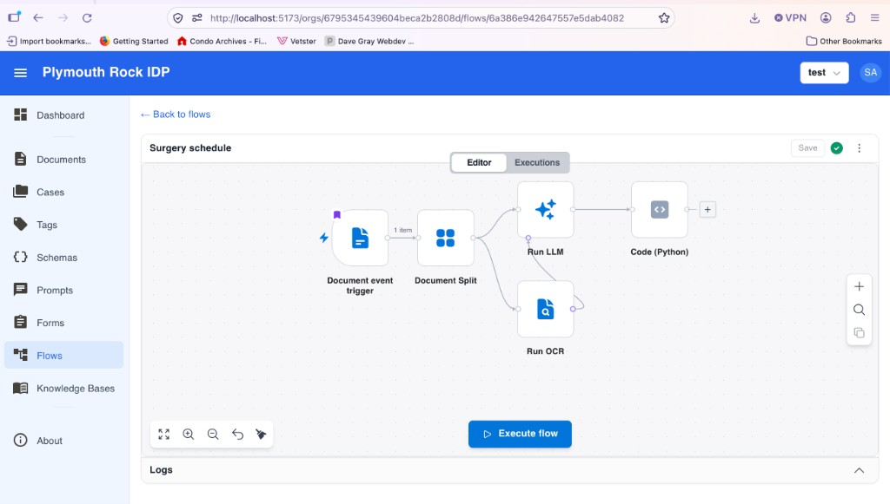

[Doc Router](https://docrouter.ai) is a document AI product: upload, OCR, extraction, review, flows. **FastAPI** already owns the hard parts—auth, APIs, workers, MongoDB. The browser app is a logged-in **React** UI, not a marketing site that needs server-rendered HTML on every request.

We migrated that UI from **Next.js** to **Vite**. The product should look the same; the stack should be easier to reason about and deploy.

## Why Not Keep Next.js?

Next.js shines when you want file-based routing, SSR, and a JavaScript server in one package. We were using it mostly as a **thick client**—while also running **session logic and API routes in Node** that duplicated what FastAPI already did.

Once login, OAuth, and session cookies lived in Python, Next’s server features bought us complexity (standalone Node images, `NEXT_PUBLIC_*` build quirks, App Router ceremony) without much benefit.

**Vite** fits our shape: build a static SPA, serve it from **nginx**, call **FastAPI** with cookies and `/fastapi` in dev.

## Simpler Framework, More Control

Generating code is easy. A simpler framework is still worth it: less to debug, fewer deploy paths, and more control over routing and auth.

We did not redesign Doc Router. We moved the same React UI onto Vite.

## Architecture: Before and After

  
Loading diagram...

  <strong>Figure 1:</strong> Before and after the Next.js → Vite migration.

  <a href="/excalidraw-edit?file=/assets/excalidraw/doc-router-nextjs-to-vite-architecture.excalidraw" target="_blank" style="color: #2563eb; text-decoration: none; font-weight: 500;">
    Edit in Excalidraw
  </a>

Previously the browser talked to the **Next.js UI**, the **Next.js server** (API routes and session), and **FastAPI**; both Node and Python reached the **database**. Now it loads a **static Vite SPA**, calls **FastAPI** for everything the Node server used to handle, and only FastAPI talks to the database.

## What We Replaced (at a Glance)

<table class="min-w-full text-sm border border-gray-200 rounded-lg overflow-hidden">
  <thead class="bg-slate-100">
    <tr>
      <th class="text-left p-3 font-semibold">Next.js</th>
      <th class="text-left p-3 font-semibold">Vite + React Router</th>
    </tr>
  </thead>
  <tbody class="divide-y divide-gray-200">
    <tr><td class="p-3">App Router <code>src/app/</code></td><td class="p-3"><code>src/router.tsx</code> + <code>src/pages/</code></td></tr>
    <tr class="bg-slate-50"><td class="p-3"><code>next/navigation</code>, <code>next/link</code></td><td class="p-3">React Router + small <code>appRouter</code> helpers</td></tr>
    <tr><td class="p-3"><code>next/image</code>, <code>next/dynamic</code></td><td class="p-3"><code>AppImage</code>, <code>React.lazy</code></td></tr>
    <tr class="bg-slate-50"><td class="p-3">Next API routes / Node session</td><td class="p-3">FastAPI cookie + <code>GET /v0/account/auth/session</code></td></tr>
    <tr><td class="p-3">Node server in production</td><td class="p-3"><code>dist-vite/</code> on nginx (:80, edge often :3000)</td></tr>
    <tr class="bg-slate-50"><td class="p-3"><code>NEXT_PUBLIC_*</code></td><td class="p-3"><code>VITE_*</code> via <code>publicEnv.ts</code></td></tr>
  </tbody>
</table>

## Same Look and Feel

We kept **MUI**, **Tailwind**, **Form.io**, and the same layout shells (org, settings, dashboard). Branding still comes from env vars baked at build time. Users get the same flows—not a new skin.

## How We Migrated (Short Version)

1. **Backend first** — moved all the Next.js server APIs to FastAPI.
2. **Vite side by side with Next.js.**
3. **Route parity** — same URLs, now in React Router.
4. **Remove Next.** CI and Docker build Vite only.
5. **Cleanup.**

The port took **two days**. Roughly **47 commits** on the `vite` branch: **258 files**, about **18k** lines touched (inserts + deletes). The frontend package ended **smaller** after removing the App Router tree (~900 net lines gone there).

The code migration was done in Cursor with **Composer 2.5 Fast**. This post was written with **Grok**, the latest Grok coding model.

## Safety Net: Python Unit Tests

Before we trusted the new SPA path, we leaned on **backend tests** so auth behavior did not regress:

- **`test_account_auth.py`** — password login, JWT payload, httpOnly `Set-Cookie`, unverified email rejection.
- **`test_feedback.py`** — authenticated feedback submit and admin list/delete (logic that used to live in Next route handlers).

Those tests run with **`make test`** / pytest on every change. The UI could switch frameworks; **the contract with FastAPI had to stay stable**.

Frontend **Vitest** tests stayed in place for hooks and components; the migration did not remove client test coverage.

## Conclusion: When to Pick Which Front End

| You want… | Consider |
|-----------|----------|
| SSR, SEO, file-based app + server components | **Next.js** |
| API already in Python/Go/etc., static deploy, cookie session API | **Vite + React Router** |

Doc Router is firmly in the second column—the same column as our earlier post on [background jobs in FastAPI]().

