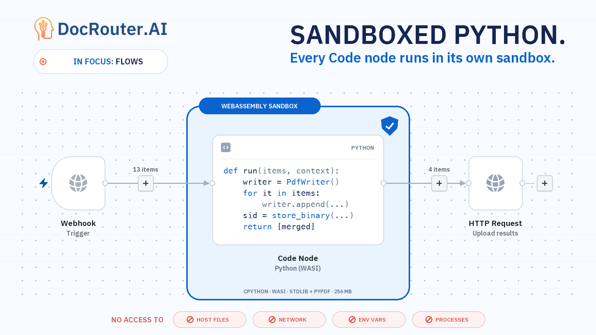

[DocRouter Flows]() lets you chain document steps: a trigger, OCR, an LLM extraction, an HTTP call. When no built-in node fits, you drop in a **Code (Python)** node and write a function:

```python
def run(items, context):
    return [{"json": {"total": sum(i["json"]["amount"] for i in items)}}]
```

DocRouter is multi-tenant, so that function is untrusted code running on shared workers. This post explains why the obvious way to run it, a Python child process, is not safe, how the Code node runs Python in a WebAssembly sandbox instead, and how to work with PDFs using `pypdf`, the PDF library available inside the sandbox.

## The Pitfalls of Spawning a Python Process

The simplest design is to start a Python subprocess, check the source for dangerous imports, remove built-ins such as `eval` and `open`, strip the environment, and kill the process after a timeout. It looks careful. It is not a security boundary.

**A Python block list can be walked around.** Python objects lead to other Python objects. A running generator knows its frame, a frame knows the frame that called it, classes know their subclasses, and somewhere along those links are real modules. A few lines of ordinary-looking code can pass a list of blocked names and attributes and still reach `os`. Each path you block leaves the next one a single attribute away. The list never ends, because you are trying to remove capabilities from a language that was designed to expose them.

Once code escapes the checks, it can access files on disk, the network, any environment variables, and it can start other processes.

## What We Considered

<div class="overflow-x-auto my-6">
<table class="min-w-full text-sm border border-gray-200 rounded-lg overflow-hidden">
  <thead class="bg-slate-100">
    <tr>
      <th class="text-left p-3 font-semibold">Option</th>
      <th class="text-left p-3 font-semibold">Isolation</th>
      <th class="text-left p-3 font-semibold">Cost</th>
    </tr>
  </thead>
  <tbody class="divide-y divide-gray-200">
    <tr><td class="p-3">Python process with a block list</td><td class="p-3">None real: the next path is one attribute away</td><td class="p-3">Endless</td></tr>
    <tr class="bg-slate-50"><td class="p-3">Container or microVM per run</td><td class="p-3">Strong</td><td class="p-3">New infrastructure, slow cold starts, hard to run on a laptop</td></tr>
    <tr><td class="p-3">Serverless function (AWS Lambda)</td><td class="p-3">Strong; allows compiled packages</td><td class="p-3">Cloud-only, network hop, deployment per environment</td></tr>
    <tr class="bg-slate-50"><td class="p-3"><strong>CPython on WebAssembly (WASI)</strong></td><td class="p-3">Strong: the guest only gets what we hand it</td><td class="p-3">Standard library and pure-Python packages only</td></tr>
  </tbody>
</table>
</div>

We picked WebAssembly. A WebAssembly module cannot touch anything on the host unless the host explicitly passes it in. There is no file system, network, environment or process API to forget to block. The runtime, [wasmtime](https://wasmtime.dev/), runs inside the DocRouter worker, so there is nothing extra to deploy, and it works the same on macOS, Linux and in our containers. The runner sits behind a small interface (one request in, one result out), so a Lambda runner can be added for flows that need compiled packages.

## How the Code Node Works

Your function runs in CPython compiled to WebAssembly. The sandbox gets:

- The Python standard library, **read-only**.
- A few pinned pure-Python packages, **read-only**. Today that is [`pypdf`](https://pypi.org/project/pypdf/).
- One JSON request on standard input: your code, the items, the context, and the input files.

It gets nothing else: no host files, no network, no environment variables, no processes. Memory is capped (256 MB by default) and runs stop at the node's timeout.

Files go through the worker, which checks them:

- **`read_binary(storage_id)` returns only this node's input files.** The worker fetches them before the run, checks that they belong to the run's organization, and passes them in (up to 10 MB per file and 32 MB per run).
- **`store_binary(...)` returns a placeholder id.** The worker stores the bytes for the run after your code finishes.
- **An output item may only reference an input file or a file you stored.** Anything else fails the node.

The file reader that every node shares applies the same rule. A stored file is read only if it belongs to the run's organization: a document of that organization, a file from one of its runs, or a pinned file of one of its flows. HTTP Request, Gmail, Google Drive, OneDrive, OCR and Document Split all go through it.

The Code node also checks the source before running it: a module allow-list and a few blocked names. These checks catch mistakes early and give clear errors, but they are a second layer. The sandbox is the boundary.

The same sandbox runs the **Tool Code** node, which exposes Python as a tool to an LLM agent.

### Two Implementation Details

**The WebAssembly build of CPython has no `zlib`.** PDFs compress almost everything with zlib (Flate), including the structures you need just to open a file, so `pypdf` cannot read real PDFs without it. We ship a small pure-Python `zlib` inside the sandbox. It decompresses fully. Its compressor writes valid but uncompressed output, which is fine for merging and splitting.

**Compiling Python is the slow part.** The sandbox cannot write bytecode caches, so without help every run would compile the source of every module it imports: about 0.2 seconds for an empty function, and another 0.65 seconds to import `pypdf`. We compile the bytecode once at install time, with the sandbox's own interpreter. An empty run takes about 0.05 seconds, and a real flow that groups a 13-page packet by patient and merges one PDF per patient runs in about a third of a second.

## Working with PDFs: `pypdf`

The sandbox runs pure Python only. Packages with compiled C extensions cannot load in it, so a Code node that imports one fails with a refused import or "No module named ...". For PDFs, the sandbox includes [`pypdf`](https://pypi.org/project/pypdf/), which is pure Python. Most PDF work in flows is page work: merge, split, select, rotate, count. `pypdf` does all of that.

### The Pattern

1. Import it:

   ```python
   import io
   from pypdf import PdfReader, PdfWriter
   ```

2. Open a PDF from the bytes `read_binary` gives you:

   ```python
   raw = base64.b64decode(read_binary(ref["storage_id"]))
   reader = PdfReader(io.BytesIO(raw))
   ```

3. Build output with a `PdfWriter`, then turn it into bytes for `store_binary`:

   ```python
   buf = io.BytesIO()
   writer.write(buf)
   pdf_bytes = buf.getvalue()
   ```

4. Give the node enough time. `pypdf` is pure Python; set the timeout to 10 to 30 seconds for large packets.

### Cheat Sheet

<div class="overflow-x-auto my-6">
<table class="min-w-full text-sm border border-gray-200 rounded-lg overflow-hidden">
  <thead class="bg-slate-100">
    <tr>
      <th class="text-left p-3 font-semibold">Task</th>
      <th class="text-left p-3 font-semibold"><code>pypdf</code></th>
    </tr>
  </thead>
  <tbody class="divide-y divide-gray-200">
    <tr><td class="p-3">Open from bytes</td><td class="p-3"><code>PdfReader(io.BytesIO(raw))</code></td></tr>
    <tr class="bg-slate-50"><td class="p-3">New empty document</td><td class="p-3"><code>PdfWriter()</code></td></tr>
    <tr><td class="p-3">Page count</td><td class="p-3"><code>len(reader.pages)</code></td></tr>
    <tr class="bg-slate-50"><td class="p-3">Append a whole PDF</td><td class="p-3"><code>writer.append(reader)</code></td></tr>
    <tr><td class="p-3">Append pages 2–3</td><td class="p-3"><code>writer.append(reader, pages=(1, 3))</code></td></tr>
    <tr class="bg-slate-50"><td class="p-3">Pick and reorder pages</td><td class="p-3"><code>for i in [3, 0]: writer.add_page(reader.pages[i])</code></td></tr>
    <tr><td class="p-3">Rotate a page</td><td class="p-3"><code>writer.pages[0].rotate(90)</code></td></tr>
    <tr class="bg-slate-50"><td class="p-3">Page text</td><td class="p-3"><code>reader.pages[i].extract_text()</code></td></tr>
    <tr><td class="p-3">Save to bytes</td><td class="p-3"><code>writer.write(buf); buf.getvalue()</code></td></tr>
  </tbody>
</table>
</div>

### Example: One PDF per Patient

A common flow splits a scanned packet into pages, runs OCR and an LLM on each page, then groups the pages by patient and merges each group into one PDF. The grouping logic is plain Python. Only the merge function touches the PDF library:

```python
import base64
import io
from pypdf import PdfReader, PdfWriter

def merge_patient_pdf(page_indices):
    writer = PdfWriter()
    for page_idx in page_indices:
        _name, ref = pdf_binary_meta(items[page_idx])
        if not ref:
            continue
        raw = base64.b64decode(read_binary(ref["storage_id"]))
        writer.append(PdfReader(io.BytesIO(raw)))
    if len(writer.pages) == 0:
        return None
    buf = io.BytesIO()
    writer.write(buf)
    return buf.getvalue()
```

The node then stores each merged PDF with `store_binary("application/pdf", file_name, base64.b64encode(merged).decode("ascii"))` and returns the id on the output item.

### What `pypdf` Will Not Do

`pypdf` works with PDF structure. It does not render pages to images, and it does not OCR. If you need rasterized pages or text from scans, use the built-in **Document Split** and **OCR** nodes in front of the Code node, and keep the Code node for the logic.

### Other Rules for Code Nodes

- **`read_binary` only sees this node's inputs.** To read a file, connect the node that produces it to the Code node.
- **Returned files must come from `store_binary` or the inputs.** Returning another `storage_id` fails the node.
- **Allowed imports** are a short list of standard-library modules (`json`, `re`, `math`, `datetime`, `collections`, `itertools`, `functools`, `hashlib`, `base64`, `uuid`, `typing`, `decimal`, `statistics`, `string`, `textwrap`, `random`, `io`) plus `pypdf`. Operators can change the list.

## For Self-Hosted Installs

Nothing to install by hand: the Docker image includes the WebAssembly runtime, the pinned CPython build and `pypdf`, all checked by SHA-256 and precompiled at build time. `make setup-python` does the same for development.

If you run a single-tenant install where every flow editor is trusted, and you need a compiled package, you can run Code nodes in an unsandboxed Python subprocess with `FLOW_CODE_RUNNER=local` and `FLOW_CODE_ALLOW_UNSANDBOXED=true`, and list the package in `FLOW_CODE_EXTERNAL_ALLOW`. Both settings are required on purpose: every pitfall above applies. Do not do this where flow editors come from different customers.

If you have a Code node that does not fit the sandbox, [contact us](/contact/) with what it does and we will help.
