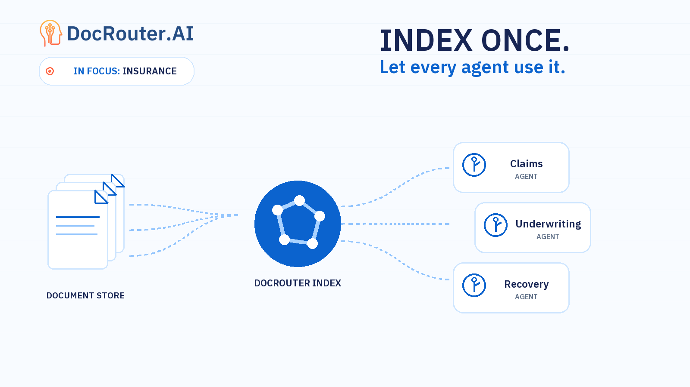
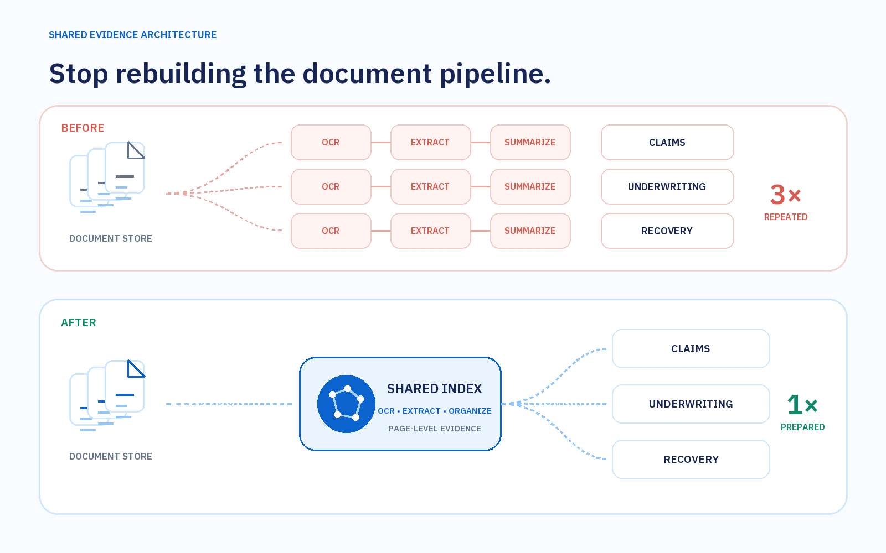
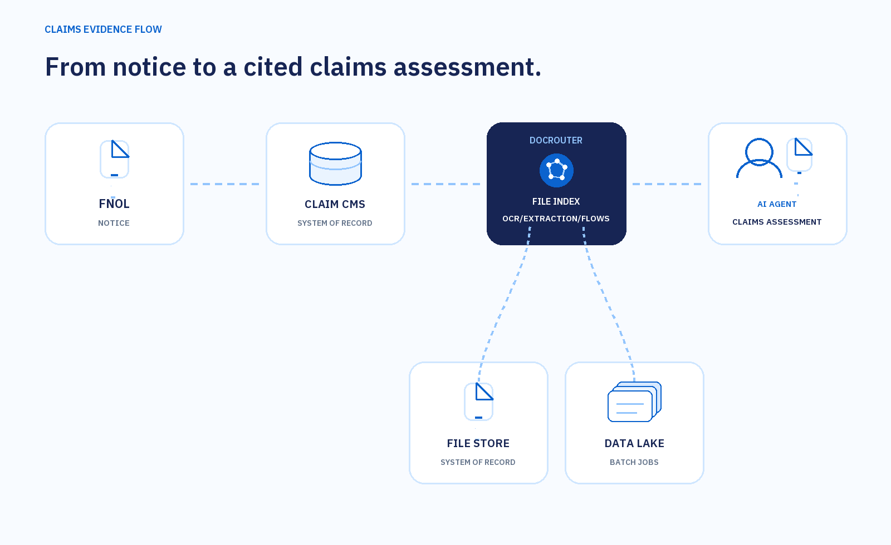

An AI workflow reviews a claim and misses a policy exclusion.

The model may not be the problem. The right page may never have reached it.

That is the document problem insurers face as they move from extraction pilots to production agents. The files already exist: claims packets, forms, endorsements, loss runs, and submissions. But storing a document is not the same as making its evidence usable by AI.

The answer is a reusable document index:

> **Index the documents once. Let every agent use them.**

This is the application we are discussing at the Datos Insights Insurance AI Showcase—and a capability we added to DocRouter. The open-source release does not include it yet; we plan to bring it there.

## From fields to evidence

Eighteen months ago, the common request was:

> Read this form and return these fields.

That work still matters. Today, carriers are also asking:

- Is this loss likely covered?
- Which endorsement controls?
- What is missing from the submission?
- What evidence supports the answer?

Those are not single-document extraction questions. They require the right pages from the right documents, in context.

A data lake does not solve that by itself. It can store and process files at scale. It does not automatically tell an agent which page matters.

Without an index, every team builds another pipeline. Each workflow may OCR, classify, extract, and summarize the same documents again. That creates three problems:

1. Important pages can be missed.
2. Model cost is duplicated.
3. Each workflow develops its own version of the evidence.

## The reusable layer

DocRouter can store documents directly. At carrier scale, however, the usual architecture is to leave terabytes of files in the existing content system or data lake. DocRouter sits beside that system, indexes the documents in place, and retrieves source pages on demand. This avoids duplicating the document store while making it usable by people and AI agents.

A document index would keep track of each file, its metadata, and its processed contents. Tags would determine which documents go through OCR, extraction, and knowledge-base ingestion. An agent could retrieve the relevant page while the original file remains in the carrier's document store.

That changes the architecture:

**Before:** every workflow rebuilds document processing.

**After:** workflows share one prepared, page-level source of evidence.

A claims investigation agent and a later recovery workflow could use the same indexed policy packet. Agents built inside DocRouter—or in an insurer's existing platform—could call the same index through an API.

The benefit is not just lower cost. It is consistency. Every workflow starts from the same documents, page references, and derived information.

## A claims example

After first notice of loss, a claim may be open while the first coverage pass still requires an adjuster to search through forms and endorsements.

An indexed workflow could:

1. Gather the notice of loss.
2. Look up the policy and the claim.
3. Use DocRouter for the file index, OCR, extraction, and flows.
4. Run the claims assessment AI agent, with the original pages attached.

The agent recommends. The adjuster decides.

The original page stays attached, so the reviewer can see what the agent used. If a required loss run has not arrived, the output says it is missing rather than inventing an answer.

We describe the agent loop in more detail in [From First Notice to First Answers]({{ site.baseurl }}). The index is the layer underneath: the governed evidence available to that agent.

The same pattern applies to underwriting and submission intake. An MGA may use email, an API, or a bucket instead of a full policy administration system. The need is unchanged: classify the documents, organize them, and put the right evidence in front of the workflow.

## Prove retrieval before automating decisions

The central test is not whether the model can produce a polished answer. Agents have gotten quite good with that! It is whether the agent found the evidence an expert would use.

A focused proof of concept can start with one workflow and a small set of expert-reviewed cases. Measure:

- Did retrieval find the relevant pages?
- Which pages did it miss?
- How often did a reviewer correct the result?
- How much repeated document processing did the shared index remove?

This keeps the first project concrete. It also avoids promising production scale from a two-week proof of concept. The proof establishes whether the evidence path works; production engineering follows.

## What the carrier provides

The carrier provides access to the relevant documents, a narrow first workflow, and a subject-matter expert who can identify the right evidence.

That expert is often the scarce resource. The model is available. The person who knows what a drawer means—and which endorsement controls—is usually busy running the business.

For a large carrier, the long pole may be security review and integration. A service account can limit what the connector reads. On-demand access avoids making another uncontrolled copy of the document store. An on-premises or private deployment can keep file bytes inside the carrier's environment.

For a smaller carrier or MGA, the first task may be consolidating documents spread across inboxes, buckets, and agency systems. The scope is narrower, but more of the foundation may need to be assembled.

## FAQ

### We already have a data lake. Why do we need an index?

A data lake stores and processes documents at scale. The index makes their contents discoverable at page level, so an agent can retrieve relevant evidence without reprocessing the full document store.

### How current is the information?

The index can update as new files arrive. For values that must be current at decision time, such as a structured policy field, the workflow should query the source system directly. Freshness depends on the integration and should be measured.

### Where does human oversight remain?

Low-confidence or high-stakes cases go to a person. The index makes review faster by keeping the supporting page attached. It does not decide whether to deny a claim or accept a risk.

### What should a CTO ask an AI vendor?

Ask: **Which pages did the workflow retrieve, why those pages, and how will you measure missed evidence over time?**

Then test the system on cases labeled by your own experts. A polished answer is not enough if the supporting page never surfaced.

### What does success look like in a proof of concept?

Start with one workflow. Agree on an expert-reviewed test set and a target for finding the necessary pages. Track missed evidence and reviewer corrections. Do not confuse a successful retrieval test with proof of production-scale performance.

### How do carriers think about ROI?

The immediate gains are shorter cycle time, less manual evidence gathering, fewer incomplete assessments, and less repeated OCR, extraction, and summarization. This is usually a cost-avoidance and quality play—not a promise to replace adjusters or underwriters.

### What about prompt debt?

Prompts, extraction schemas, and workflows should be versioned together. Teams need to know which configuration produced each result and test changes against an offline set of real cases. Indexing also reduces one-off prompts because later agents query prepared evidence instead of repeatedly interpreting raw files.

### How is this different from form-processing software?

Form-processing products optimize the job of extracting fields and keying them into another system. A reusable index optimizes a different job: preparing a live document store so multiple agents can find and cite the evidence they need.

### What is the key takeaway?

